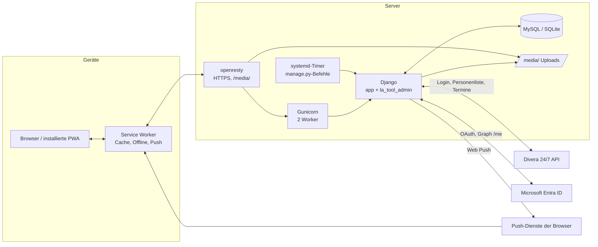
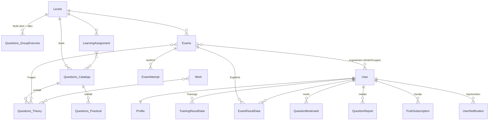
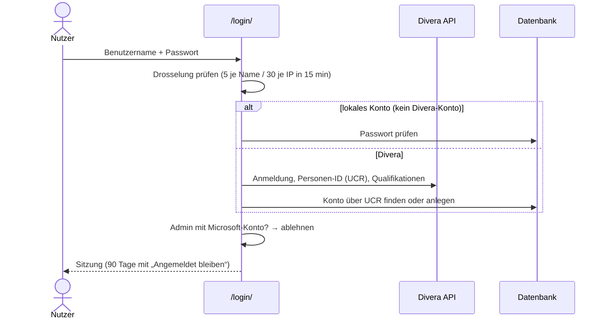

# Architektur

Wie das LA-Tool aufgebaut ist, welche Teile wofür zuständig sind und wie die Daten fließen. Für die Einrichtung siehe [Entwicklung](entwicklung.md), für den Server [Deployment](deployment.md).

## Zweck und fachlicher Rahmen

Das LA-Tool bereitet Jugendliche der THW-Jugend Gelsenkirchen auf das **Leistungsabzeichen (LA)** der THW-Jugend vor (Stufen Bronze, Silber, Gold). Es ersetzt nicht die offizielle Abnahme, sondern dient dem Üben:

| Bereich | Was das Tool bietet |
|---|---|
| Theorie | Multiple-Choice-Training mit Lernkartei („Heute lernen“), Nachschlagen mit Lösungen, Lernstand, Lernaufträge |
| Praxis, Gruppenaufgaben | Aufgabenbeschreibungen (PDF/Bild) und Selbsteinschätzung |
| Prüfungen | Übungsprüfungen mit Zeitlimit; Ergebnis erst nach Freigabe durch einen Admin |
| Dienste | Termine der Jugendgruppe aus Divera 24/7, ergänzt um Stufe und zugehörige Aufgaben |
| Admin-Bereich | Pflege von Stufen, Katalogen, Fragen, Prüfungen, Diensten, Nutzern, Rechten; Lernstand-Übersicht |

Nutzer: ca. 20–40 Jugendliche (überwiegend Smartphone) und 5–7 Betreuer/Ausbilder (Admin-Bereich, meist Desktop).

## Technologien

| Schicht | Technik | Hinweis |
|---|---|---|
| Sprache, Framework | Python 3.13, Django 6.0 | Versionen in [`requirements.txt`](../requirements.txt) |
| Oberfläche | Django-Templates, Tailwind CSS v4, Alpine.js | Tailwind über `django-tailwind-cli` (Standalone-Binary, kein Node.js); Alpine und pdf.js liegen lokal in `app/static/vendor/` |
| App | Progressive Web App | Manifest, Service Worker, Offline-Funktionen, Web Push (`pywebpush`) |
| Datenbank | SQLite (Entwicklung), MySQL (Produktion, Treiber `mysqlclient`) | Auswahl über `DATABASE_TYPE` |
| Anmeldung | Divera 24/7 (REST), Microsoft Entra ID (OAuth 2.0 via `msal`), lokales Passwort | siehe [Anmeldung](#anmeldung-und-konten) |
| Auslieferung | Gunicorn, WhiteNoise für `/static/`, Reverse-Proxy (openresty) davor; Ziel: Docker Compose auf dem VPS | [Deployment](deployment.md), [Entscheidung 0001](entscheidungen/0001-deployment-strategie.md) |

## Systemüberblick

## Aufbau des Repositorys

| Pfad | Inhalt |
|---|---|
| `la_tool/` | Projekt-Konfiguration: `settings.py`, `env.py` (liest die `.env`), `urls.py`, `wsgi.py` |
| `app/` | Nutzerseite: Views, Modelle der Inhalte und Ergebnisse, Lernlogik, PWA, Divera-Login, Management-Befehle |
| `la_tool_admin/` | Admin-Bereich unter `/admin/`, Konten-Modelle (`Profile`, Push, Benachrichtigungen), IdP-Gruppenabgleich |
| `tailwind/source.css` | Design-Tokens und Komponenten-Klassen (Quelle) → gebaut nach `assets/css/tailwind.css` (eingecheckt) |
| `app/static/` | JavaScript (`js/app.js`), Bilder, PWA-Icons, Startbilder, Vendor-Bibliotheken |
| `docs/` | Diese Dokumentation |

Nicht im Repository (siehe `.gitignore`): `.env`, `db.sqlite3`, `media/`, `staticfiles/`, **Migrationen** (`*/migrations/`, Umstellung beschlossen), `divera.json` (lokale Entwicklungshilfe), `old/`.

### Module in `app/`

| Datei | Verantwortung |
|---|---|
| `views.py` | Alle Nutzerseiten: Start, Übungen, Training, Nachschlagen, Lernstand, Prüfungen, Dienste, Profil, Benachrichtigungen, Rechtstexte, Health-Check |
| `models.py` | Stufen, Kataloge, Fragen/Aufgaben, Ergebnisse, Prüfungen, Dienste, Merkliste, Meldungen, Lernaufträge |
| `learning.py` | Lernstand und Lernkartei: Beherrschung, Status, Fälligkeit, „Heute lernen“, Bereitschafts-Ampel, Verlauf |
| `scoring.py` | Bewertung einer Antwort (alles-oder-nichts oder Teilpunkte je Katalog) |
| `login_function.py` | Divera-Anmeldung und -Verknüpfung, Entra-Pflicht für Admins, Login-Drosselung, „Angemeldet bleiben“ |
| `pwa.py` | Manifest, Service Worker (`templates/pwa/sw.js`), Offline-Seite, Push-An-/Abmeldung |
| `context_processors.py` | LA-Stufe der Sitzung, aktiver Menüpunkt, Zähler (ungelesene Nachrichten, fällige Fragen) |
| `middleware.py` | Verlängert dauerhafte Sitzungen bei Nutzung |
| `legal_info.py` | Angaben und Aufbewahrungsfristen für Datenschutz/Impressum/Löschkonzept |
| `images.py` | Verkleinert Stufen-Icons beim Hochladen (WebP) |
| `apps.py` | `post_migrate`-Hook: alte Katalog-Zuordnung von Gruppenaufgaben auf Stufen übertragen |
| `management/commands/` | Befehle für Timer und Wartung, siehe [Befehle](referenz/befehle.md) |

### Module in `la_tool_admin/`

| Datei | Verantwortung |
|---|---|
| `views.py` | Admin-Seiten, Microsoft-Login (`microsoft_login`, `microsoft_callback`), Rechteprüfung `admin_permission_required` |
| `forms.py` | Formulare für Stufen, Kataloge, Fragen, Prüfungen, Dienste, Import, Push, Lernaufträge |
| `models.py` | `Profile`, `AutoGroupRule`, `PinnedGroup`, `DiveraQualification`, `PushSubscription`, `UserNotification`, `Changes` (ungenutzt) |
| `push.py` | Web-Push-Versand, speichert jede Nachricht als `UserNotification` |
| `utils.py` | Gruppenabgleich aus Entra/Divera (`sync_idp_groups`), Festsetzen von Gruppen |

## Datenmodell

Vereinfacht, ohne Hilfsfelder. Vollständige Felder: [Datenmodell-Referenz](referenz/datenmodell.md).

Wichtige Eigenschaften:

- **Entwurf:** Stufen, Kataloge, Fragen, Aufgaben und Dienste haben `is_draft`. Nutzer sehen nur Inhalte, deren Kette (Frage → Katalog → Stufe) komplett freigegeben ist (`_published()` in `app/views.py`, `learning.published_theory()`).
- **Antworten** werden als Buchstaben (`a`, `b`, …) zur Position in `answer_choice` gespeichert; richtig ist, was in `answer_correct` (Texte) steht.
- **Lernstand ohne eigene Tabelle:** Beherrschung, Fälligkeit und Ampel werden bei Bedarf aus `TrainingResultData` berechnet (`app/learning.py`).
- **Laufende Prüfungen** liegen in `ExamAttempt` (nicht in der Sitzung), damit Zeit und Zwischenstand Gerätewechsel und Abmelden überstehen. Bei der Abgabe wird der Versuch atomar gelöscht und `ExamResultData` angelegt.
- **Benachrichtigungen** werden bei jedem Push als `UserNotification` gespeichert (Glocke, Zähler am App-Symbol).

## Anmeldung und Konten

Konten liegen immer lokal (`django.contrib.auth`, `ModelBackend`); Divera und Entra sind Wege, sich anzumelden und Daten zu übernehmen.

- **Divera:** Das Konto wird über die feste Divera-ID (UCR) zugeordnet, nie über den Namen allein. Der persönliche Divera-Accesskey wird nicht gespeichert. Das Passwort wird nur als Hash für den Fall gespeichert, dass Divera nicht erreichbar ist.
- **Microsoft Entra:** Authorization-Code-Flow mit PKCE und Nonce (`msal.initiate_auth_code_flow`), Scope `User.Read`. Zuordnung über die Entra-Objekt-ID, sonst die Mail (ohne Groß/klein); fremde Tenants und Gastkonten werden abgelehnt. Die Gruppen-IDs kommen aus Graph `/me/memberOf`.
- **Entra-Pflicht:** Admins mit verknüpftem Microsoft-Konto können sich nur über Microsoft anmelden.
- **Erste Anmeldung ohne Divera-Verknüpfung:** Der First-Run-Wizard (`/first-run/`) bietet die Verknüpfung per Divera-Zugangsdaten oder Accesskey an (der Key wird nur zur Prüfung genutzt).

### Gruppen und Rechte

Berechtigungen sind Django-Permissions der App `app` (17 Stück, Liste in [Sicherheit & Datenschutz](sicherheit-datenschutz.md#rollen-und-rechte)). Jede Admin-Seite verlangt `access_admin` plus ein Einzelrecht.

Gruppenmitgliedschaften berechnet `sync_idp_groups` nach jeder Anmeldung und beim nächtlichen Abgleich aus

1. **Auto-Gruppen-Regeln** (Admin → Autogruppen): Divera-Qualifikationen und/oder Entra-Gruppen → Django-Gruppe,
2. dem festen Mapping `AZURE_GROUP_ADMINS_ID` → „LA-Tool-Admins“, `AZURE_GROUP_USERS_ID` → „LA-Tool-Benutzer“.

Entfernt wird eine Gruppe nur, wenn alle beteiligten Quellen bekannt sind. Unter Admin → Benutzer **festgesetzte** Gruppen entfernt der Abgleich nie.

## Externe Integrationen

| Dienst | Wofür | Code | Konfiguration |
|---|---|---|---|
| Divera 24/7 | Login, Personendaten, Qualifikationen; Personenliste und Termine mit dem Admin-Key | `app/login_function.py`, `sync_divera`, `sync_divera_users` | `DIVERA_*` |
| Microsoft Entra ID | Login, Gruppen | `la_tool_admin/views.py` | `AZURE_*` |
| Web Push (FCM, Mozilla, Apple, Microsoft) | Benachrichtigungen; nur bekannte Push-Hosts | `la_tool_admin/push.py` | `VAPID_*` |

Alle Aufrufe nutzen feste URLs und Timeouts; Accesskeys werden als Parameter übergeben und nicht geloggt.

## Lernlogik (Theorie)

- **Beherrschung** einer Frage = Mittel der letzten 3 Versuche (Teilpunkte anteilig). Status: gefestigt ≥ 80 %, unsicher < 50 %, sonst in Arbeit; nie geübt = neu.
- **Lernerfolg** = Mittel der Beherrschung über alle Fragen einer Menge (Stufe, Katalog, Lernauftrag).
- **Lernkartei:** 5 Fächer mit 1, 3, 7, 14, 30 Tagen Abstand. Richtig → ein Fach weiter; falsch oder teilweise richtig → zurück auf 0, sofort fällig.
- **„Heute lernen“:** fällige Fragen, dann neue (Katalog für Katalog, natürlich sortiert), dann nicht gefestigte; Fragen offener Lernaufträge zuerst.
- **Ampel „Bereit fürs LA“:** grün bei Lernerfolg ≥ Prüfungs-Bestehensgrenze der Stufe und jeder Katalog mindestens zur Hälfte geübt; gelb bis 20 Prozentpunkte darunter.

## PWA und Offline

| Funktion | Umsetzung |
|---|---|
| Installation | Manifest `/manifest.webmanifest` mit ID, Screenshots, Verknüpfungen; Startbilder für iOS (`app/static/pwa/startup/`) |
| Service Worker | `/sw.js` (Template `app/templates/pwa/sw.js`): statische Dateien aus dem Cache (mit `DEBUG` zuerst vom Server), Seiten nie gecacht |
| Ohne Netz | Offline-Seite; „Fragen nachschlagen“ aus `/uebungen/theorie/fragen/offline.json` (ohne persönliche Daten); Trainings werden im Gerät gespeichert und später gesendet |
| Push | VAPID; Zahl am App-Symbol = ungelesene Benachrichtigungen; Knopf „Jetzt üben“ in der Erinnerung |
| Rückmeldung | Ladebalken, Spinner, Hinweise (Toasts), Schutz vor Doppelklick (`app/static/js/app.js`) |

Beim Abmelden löscht der Browser gespeicherte Fragen, offene Abgaben und den App-Zähler.

## Architekturentscheidungen

| Entscheidung | Begründung |
|---|---|
| Server-gerenderte Seiten mit Alpine.js statt SPA | Kleines Team, wenige Nutzer; kein Build-Prozess für JavaScript |
| Tailwind über Standalone-Binary, gebautes CSS eingecheckt | Kein Node.js auf Entwickler-Rechnern und Server |
| Lernstand wird berechnet statt gespeichert | Eine Quelle der Wahrheit (`TrainingResultData`); keine Migrationen für Lernlogik |
| Persönliche Divera-Keys werden nicht gespeichert | Ein Key gibt Vollzugriff auf Divera; Abgleich läuft über den Admin-Key |
| Migrationen bisher nicht versioniert | Wurden auf dem Zielsystem erzeugt; Datenanpassungen über `post_migrate`-Hooks. Wird mit der Zielarchitektur auf versionierte Migrationen umgestellt ([Entscheidung 0001](entscheidungen/0001-deployment-strategie.md#schritt-2-migrationen-versionieren-einmalig)) |
| Cache im Arbeitsspeicher je Gunicorn-Worker (LocMem) | Keine zusätzliche Infrastruktur; Folgen siehe [Betrieb](betrieb.md#bekannte-einschränkungen) |
| Produktion mit Docker Compose auf einem VPS | reproduzierbar, Rollback per Image, ohne Orchestrierung; Kubernetes/PaaS verworfen ([Entscheidung 0001](entscheidungen/0001-deployment-strategie.md)) |
