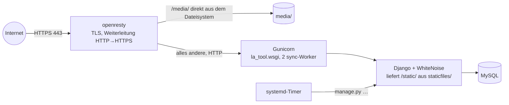

# Übergangsbetrieb (natives Deployment)

> **Gilt nur bis zur Umstellung auf die Zielarchitektur** ([Entscheidung 0001](entscheidungen/0001-deployment-strategie.md), Schritt 7). Danach wird dieses Dokument gelöscht. Die Zielarchitektur beschreibt [Deployment](deployment.md).
>
> Beschreibt das derzeitige Verfahren: venv und Gunicorn direkt auf dem VPS, manuelles Update per SSH, Migrationen werden auf dem Server erzeugt. Abschnitte mit „Beispiel“ sind nicht aus dem Repository belegt und an den Server anzupassen.

## Aufbau



| Umgebung | Zweck | Konfiguration |
|---|---|---|
| Lokal | Entwicklung, Tests | `DEBUG=True`, SQLite, `runserver` – siehe [Entwicklung](entwicklung.md) |
| Produktion | https://la-tool.thw-jugend-ge.de (VPS) | `DEBUG=False`, MySQL (oder SQLite), Gunicorn hinter openresty |

Test-/Staging-Umgebung: keine. Größere Änderungen vorher lokal mit einer Kopie der Produktionsdaten testen (`DB_SQLITE_FILE` bzw. eigene MySQL-Datenbank).

## Voraussetzungen auf dem Server

- Python 3.13 mit `venv`
- MySQL- bzw. MariaDB-Server und die Client-Bibliotheken für `mysqlclient` (Debian/Ubuntu: `default-libmysqlclient-dev`, `build-essential`, `pkg-config`)
- openresty oder nginx mit TLS-Zertifikat
- systemd

## Gunicorn

Die verwendete Konfiguration liegt **außerhalb des Repositorys** (`gunicorn.conf.py` im Verzeichnis über `la_tool/`):

```python
bind = "0.0.0.0:8000"
workers = 2
worker_class = "sync"
timeout = 120
accesslog = "-"
errorlog = "-"
loglevel = "info"
```

Läuft der Proxy auf demselben Server, genügt `bind = "127.0.0.1:8000"` – Port 8000 sollte nicht von außen erreichbar sein.

Beispiel für einen systemd-Dienst (`/etc/systemd/system/la-tool.service`, Pfade anpassen):

```ini
[Unit]
Description=LA-Tool (Gunicorn)
After=network-online.target mysql.service
Wants=network-online.target

[Service]
User=la-tool
WorkingDirectory=/srv/la-tool/la_tool
ExecStart=/srv/la-tool/venv/bin/gunicorn -c /srv/la-tool/gunicorn.conf.py la_tool.wsgi
Restart=on-failure

[Install]
WantedBy=multi-user.target
```

## Reverse-Proxy

Anforderungen an openresty/nginx:

1. HTTPS mit gültigem Zertifikat (die PWA – Service Worker, Push – funktioniert nur über HTTPS).
2. Weiterleitung von HTTP auf HTTPS (oder in Django `SECURE_SSL_REDIRECT=True`, nicht beides nötig).
3. Header `Host`, `X-Forwarded-Proto` und `X-Forwarded-For` an Gunicorn weitergeben.
4. `/media/` direkt ausliefern – Django liefert Uploads nur mit `DEBUG=True` aus.
5. `/static/` kann Django (WhiteNoise) selbst ausliefern; liefert der Proxy es aus, dann aus `staticfiles/` mit `Cache-Control: public, max-age=31536000, immutable`.

Beispiel (nginx/openresty-Syntax, Pfade anpassen):

```nginx
server {
    listen 443 ssl;
    server_name la-tool.thw-jugend-ge.de;
    # ssl_certificate … / ssl_certificate_key …

    client_max_body_size 20m;              # Datei-Uploads (PDF/Bild), Fragen-Import max. 5 MB

    location /media/ {
        alias /srv/la-tool/la_tool/media/;
    }

    location / {
        proxy_pass http://127.0.0.1:8000;
        proxy_set_header Host $host;
        proxy_set_header X-Forwarded-Proto $scheme;
        proxy_set_header X-Forwarded-For $proxy_add_x_forwarded_for;
    }
}
```

Erst wenn der Proxy `X-Forwarded-Proto: https` setzt, in der `.env` `TRUST_X_FORWARDED_PROTO=True` eintragen. Dann erkennt Django HTTPS-Anfragen (HSTS, sichere Weiterleitungen) und nimmt für die Login-Drosselung den letzten Eintrag aus `X-Forwarded-For` als Client-IP.

## Produktions-Konfiguration (`.env`)

Die `.env` liegt auf dem Server neben `manage.py` und gehört nie ins Repository. Mindestens:

```ini
DEBUG=False
SECRET_KEY=<neu erzeugt, siehe unten>
HOSTNAME=la-tool.thw-jugend-ge.de
TRUST_X_FORWARDED_PROTO=True          # erst nach Prüfung des Proxys

DATABASE_TYPE=mysql
DB_MYSQL_HOST=localhost
DB_MYSQL_PORT=3306
DB_MYSQL_USER=la_tool
DB_MYSQL_PASSWORD=<geheim>
DB_MYSQL_NAME=la_tool

AZURE_CLIENT_ID=…
AZURE_CLIENT_SECRET=…
AZURE_TENANT_ID=<Tenant-GUID, nicht „common“>
AZURE_REDIRECT_URI=https://la-tool.thw-jugend-ge.de/microsoft-callback/
AZURE_GROUP_ADMINS_ID=…
AZURE_GROUP_USERS_ID=…

DIVERA_ADMIN_USER_API_KEY=…
DIVERA_SITE_ID=20369
DIVERA_EVENTS_GROUP=Jugendliche

VAPID_PUBLIC_KEY=…
VAPID_PRIVATE_KEY=…
VAPID_SUBJECT=mailto:<kontakt-adresse>
```

Geheimnisse erzeugen:

```bash
python -c "import secrets; print(secrets.token_urlsafe(50))"      # SECRET_KEY
python manage.py generate_vapid_keys                                # VAPID-Schlüsselpaar
```

Wirkung von `DEBUG=False`: Ohne `SECRET_KEY` startet Django nicht; nur `HOSTNAME`/`EXTRA_HOSTS` sind erlaubt (sonst „400 Bad Request“); Cookies nur über HTTPS; HSTS (1 Jahr) bei HTTPS-Anfragen.

**Microsoft Entra (App-Registrierung):** Redirect-URI wie `AZURE_REDIRECT_URI`; delegierte Berechtigung `User.Read` genügt.

## Erstinstallation

```bash
# als Dienst-Benutzer, Pfade anpassen
cd /srv/la-tool
git clone https://github.com/luca-alexander-thomas/LA-Tool.git la_tool
python3.13 -m venv venv
source venv/bin/activate
cd la_tool
pip install -r requirements.txt
pip install "mysqlclient>=2.2.0"
cp .env.example .env            # dann Werte wie oben eintragen

python manage.py makemigrations app la_tool_admin
python manage.py migrate
python manage.py createsuperuser        # lokaler Notfall-Admin (ohne Microsoft-Verknüpfung)
python manage.py tailwind build
python manage.py collectstatic --noinput
python manage.py check --deploy

sudo systemctl enable --now la-tool.service
```

Danach die [Timer](betrieb.md#wiederkehrende-aufgaben-timer) einrichten (Aufruf mit `/srv/la-tool/venv/bin/python manage.py …`) und die [Verifikation](#verifikation-nach-dem-deployment) durchführen.

## Update

Ablauf bei jeder neuen Version:

1. **Backup** von Datenbank und `media/` ([Backup](betrieb.md#backup-und-wiederherstellung)) – das Backup-Verfahren ist Schritt 1 der Entscheidung und schon im Übergang einzurichten.
2. Aktuellen Stand merken (für ein Rollback): `git rev-parse HEAD > ../vorher.txt` und `pip freeze > ../vorher-requirements.txt`.
3. Code und Abhängigkeiten:

   ```bash
   cd /srv/la-tool/la_tool && source ../venv/bin/activate
   git pull
   pip install -r requirements.txt
   ```

4. Neue Variablen aus `.env.example` in die Server-`.env` übernehmen (`diff .env.example .env`).
5. Migrationen erzeugen, **prüfen**, anwenden (siehe [Migrationen](#migrationen)):

   ```bash
   python manage.py makemigrations app la_tool_admin
   python manage.py migrate --plan
   python manage.py migrate
   ```

6. Statische Dateien und Neustart:

   ```bash
   python manage.py tailwind build
   python manage.py collectstatic --noinput
   python manage.py check --deploy
   sudo systemctl restart la-tool.service
   ```

7. [Verifikation](#verifikation-nach-dem-deployment).

`collectstatic` ist Pflicht: WhiteNoise nutzt Dateinamen mit Inhalts-Hash; fehlt das Manifest `staticfiles/staticfiles.json`, bricht jede Seite mit `Missing staticfiles manifest entry` ab.

Beim Neustart gehen keine Sitzungen verloren (Datenbank-Sitzungen). Laufende Prüfungen bleiben erhalten (`ExamAttempt`), die Zeit läuft während des Neustarts weiter.

## Migrationen

Migrationsdateien sind nicht versioniert (`*/migrations/` in `.gitignore`); jede Umgebung erzeugt ihre eigenen mit `makemigrations`. Daraus folgt:

- **Vor `migrate` prüfen**, was `makemigrations` erzeugt hat (`python manage.py migrate --plan`, Dateien in `app/migrations/` und `la_tool_admin/migrations/` ansehen). Entfernte Felder oder Modelle löschen beim `migrate` Spalten bzw. Tabellen samt Daten.
- **Kein Zurückmigrieren über Git:** Die Migrationsdateien des Servers kennt nur der Server. Ein Rollback einer Version mit Modelländerungen erfolgt über das **Datenbank-Backup**.
- **Datenanpassungen** (Werte umrechnen, nicht nur Felder anlegen) stehen nicht in Migrationen, sondern in `post_migrate`-Hooks (`app/apps.py`), die bei jedem `migrate` laufen und idempotent sein müssen.
- `migrate` legt auch die Berechtigungen (`SiteSettings.Meta.permissions`) an.

## Verifikation nach dem Deployment

```bash
curl -fsS https://la-tool.thw-jugend-ge.de/healthz/          # {"status": "ok"}
curl -sI https://la-tool.thw-jugend-ge.de/login/ | grep -iE "strict-transport|content-security|x-frame"
sudo systemctl status la-tool.service
journalctl -u la-tool.service -n 50
```

Im Browser:

1. Anmeldung mit Divera und mit Microsoft (Gruppen und Rechte korrekt?).
2. Ein Training starten und abschließen.
3. Admin-Bereich öffnen.
4. Bei neuer Version: Hinweis „Neue Version“ erscheint in geöffneten Apps.

## Rollback

1. Dienst stoppen: `sudo systemctl stop la-tool.service`
2. Code zurücksetzen: `git checkout $(cat ../vorher.txt)` und `pip install -r ../vorher-requirements.txt`
3. Hatte das Update Modelländerungen: **Datenbank aus dem Backup wiederherstellen** ([Backup und Wiederherstellung](betrieb.md#backup-und-wiederherstellung)) und die auf dem Server erzeugten neuen Migrationsdateien durch die gesicherten ersetzen.
4. `python manage.py tailwind build && python manage.py collectstatic --noinput`
5. `sudo systemctl start la-tool.service` und verifizieren.

## Fehler während des Deployments

| Symptom | Ursache und Lösung |
|---|---|
| `ImproperlyConfigured: SECRET_KEY fehlt` | `.env` fehlt oder `SECRET_KEY` leer bei `DEBUG=False` |
| „400 Bad Request“ für alle Seiten | `HOSTNAME`/`EXTRA_HOSTS` passt nicht zum aufgerufenen Hostnamen |
| `Missing staticfiles manifest entry` | `collectstatic` nicht ausgeführt |
| Seiten ohne Styles | `tailwind build` vergessen oder Proxy liefert alten `/static/`-Stand |
| Endlose Weiterleitung | `SECURE_SSL_REDIRECT=True`, aber der Proxy setzt `X-Forwarded-Proto` nicht (oder `TRUST_X_FORWARDED_PROTO=False`) |
| „CSRF-Prüfung fehlgeschlagen“ beim Login | Seite über HTTP aufgerufen (Cookies sind nur über HTTPS gültig) oder Proxy gibt `Host` nicht weiter |
| `mysqlclient` lässt sich nicht installieren | Build-Pakete und MySQL-Client-Header fehlen (siehe Voraussetzungen) |
| `makemigrations` will Felder entfernen | erwartet, wenn die Version Felder entfernt (steht in den Release-Notizen bzw. Commit) – sonst abbrechen und klären |
| Microsoft-Login „State stimmt nicht überein“ | Login über eine andere Adresse als `AZURE_REDIRECT_URI` gestartet oder Sitzungs-Cookie blockiert |
