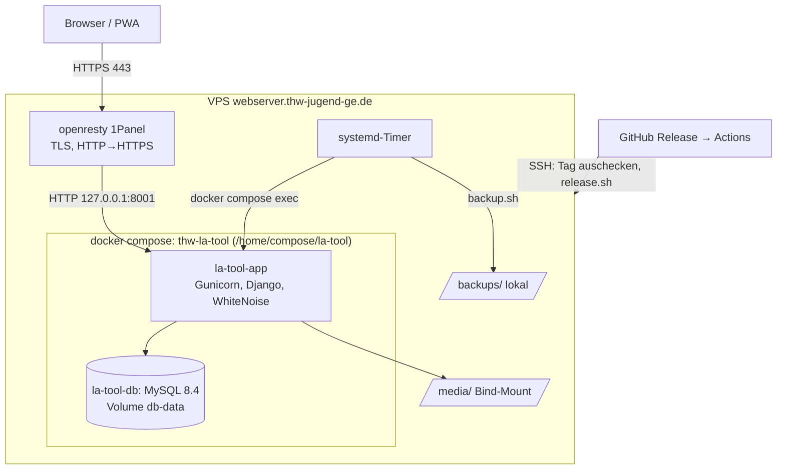

# Deployment

Bereitstellung im Produktivbetrieb: **Docker Compose auf dem VPS `webserver.thw-jugend-ge.de` hinter dem openresty von 1Panel**. Begründung und Alternativen: [Entscheidung 0001](entscheidungen/0001-deployment-strategie.md). Laufender Betrieb: [Betrieb](betrieb.md). Variablen: [Konfiguration](referenz/konfiguration.md).

> **Status (11.11.2026):** Umgesetzt und auf dem Server gestartet. Der Reverse-Proxy in 1Panel zeigt noch auf die alte 1Panel-Python-Runtime (`127.0.0.1:8000`, `/home/LA-Tool`); die Umstellung auf `127.0.0.1:8001` steht aus (siehe [Umstellung](#umstellung-von-der-1panel-runtime)).

## Umgebungen

| Umgebung | Zweck | Laufzeit | Datenbank |
|---|---|---|---|
| Entwicklung | Programmieren | venv, `runserver` ([Entwicklung](entwicklung.md)) | SQLite |
| Test | automatische Prüfung jedes Commits | GitHub Actions | SQLite (frisch je Lauf) |
| Produktion | https://la-tool.thw-jugend-ge.de | Compose-Projekt `thw-la-tool` in `/home/compose/la-tool` | MySQL 8.4 (Container) |

## Architektur



| Komponente | Aufgabe |
|---|---|
| openresty (1Panel) | TLS-Zertifikate, Weiterleitung HTTP→HTTPS, Weiterleitung an `127.0.0.1:8001` |
| `la-tool-app` | Image `la-tool-app:latest`, auf dem Server aus dem Git-Stand gebaut: Python 3.13, Gunicorn (2 Worker), Django, statische Dateien über WhiteNoise, Uploads unter `/media/`; läuft ohne Root |
| `la-tool-db` | MySQL 8.4, nur im internen Compose-Netz erreichbar, Daten im Volume `thw-la-tool_db-data` |
| `/home/compose/la-tool/` | Git-Klon des Repositorys plus `.env` (`600`), `media/`, `backups/` (nicht im Repository) |
| systemd-Timer | Management-Befehle und Backup (Units aus `deploy/systemd/`, von `deploy.sh` eingespielt) |

Der Compose-Projektname ist `thw-la-tool`, weil 1Panel den Namen `la-tool` schon für seine Python-Runtime verwendet. Gleiche Namen führen dazu, dass ein Projekt die Container des anderen als „verwaist“ entfernt.

## Dateien im Repository

| Datei | Inhalt |
|---|---|
| `Dockerfile` | Multi-Stage-Build (mysqlclient kompilieren, Laufzeit ohne Build-Werkzeuge), `collectstatic`, Healthcheck auf `/healthz/` |
| `.dockerignore` | hält `.env`, Datenbanken, `media/`, `divera.json`, `backups/` aus dem Image |
| `requirements-prod.txt` | `requirements.txt` plus Gunicorn und mysqlclient |
| `compose.yaml` | Dienste `app` und `db`, Port `127.0.0.1:8001`, Log-Rotation |
| `deploy/gunicorn.conf.py` | Gunicorn-Einstellungen |
| `deploy/deploy.sh` | Update-Ablauf mit Backup, Migration, Healthcheck und Rollback |
| `deploy/backup.sh` | Datenbank-Dump und `media/` nach `backups/` |
| `deploy/systemd/` | Timer für Management-Befehle und Backup (`@DIR@` ersetzt `deploy.sh` durch das Projektverzeichnis) |
| `.github/workflows/ci.yml` | bei jedem Push: `check`, `makemigrations --check`, Tests, `pip-audit`, Image-Build |
| `.github/workflows/deploy.yml` | nur beim Veröffentlichen eines GitHub-Releases (keine Vorabversion): Tests, dann Deploy per SSH |
| `deploy/release.sh` | Release-Tag auschecken, `release.json` schreiben, `deploy.sh` ausführen |

## Konfiguration

`/home/compose/la-tool/.env` (Besitzer root, `chmod 600`). Variablen siehe [Konfiguration](referenz/konfiguration.md); Produktionswerte:

```ini
SECRET_KEY=<python3 -c "import secrets; print(secrets.token_urlsafe(50))">
DEBUG=False
HOSTNAME=la-tool.thw-jugend-ge.de
TRUST_X_FORWARDED_PROTO=True        # der Proxy setzt X-Forwarded-Proto und X-Forwarded-For

DB_MYSQL_NAME=latool
DB_MYSQL_USER=latool
DB_MYSQL_PASSWORD=<geheim>
DB_MYSQL_ROOT_PASSWORD=<geheim>     # nur für den MySQL-Container

AZURE_…, DIVERA_…, VAPID_…          # wie in .env.example
AZURE_REDIRECT_URI=https://la-tool.thw-jugend-ge.de/microsoft-callback/
VAPID_SUBJECT=https://la-tool.thw-jugend-ge.de
```

`DATABASE_TYPE=mysql`, `DB_MYSQL_HOST=db` und `DB_MYSQL_PORT` setzt `compose.yaml`. Den MySQL-Container initialisiert Compose aus denselben `DB_MYSQL_*`-Werten. Werte dürfen kein `$` enthalten (Compose interpoliert sie).

Das Image enthält keine Geheimnisse. Die `.env` gehört ins Offsite-Backup, sobald es eingerichtet ist.

**Reverse-Proxy (1Panel → Website → Reverse-Proxy):** Ziel `http://127.0.0.1:8001`. Nötig sind die Header `Host`, `X-Forwarded-Proto` und `X-Forwarded-For` (Standard bei 1Panel), sowie `client_max_body_size` ≥ 20 MB für Uploads. `/media/` muss nicht gesondert eingerichtet werden; Django liefert die Uploads selbst aus.

**Microsoft Entra (App-Registrierung):** Redirect-URI wie `AZURE_REDIRECT_URI`, delegierte Berechtigung `User.Read`.

## Release-Prozess

Deployt wird **nur über ein GitHub-Release**. Pull-Requests, Pushes und Merges laufen nur durch die CI (`ci.yml`).

1. Änderungen per Pull-Request nach `main`; die CI muss grün sein.
2. In GitHub ein Release veröffentlichen (Releases → Draft a new release): neuen Tag auf `main` anlegen, z.&nbsp;B. `v1.3.0`, Titel und Release-Notizen schreiben (oder „Generate release notes“). Erlaubte Tag-Zeichen: Buchstaben, Ziffern, `.`, `_`, `-`. Als **Vorabversion** markierte Releases werden nicht deployt.
3. `deploy.yml` startet beim Veröffentlichen: Tests auf dem Tag, dann per SSH auf dem Server `git fetch --tags`, `git checkout --detach refs/tags/<tag>` und `bash deploy/release.sh <tag> <daten>`.
4. `release.sh` schreibt Tag, Titel, Notizen, Datum und Link des Releases nach `release.json` (nicht im Repository, wird ins Image gebaut) und ruft `deploy.sh` auf.
5. `deploy.sh`:
   1. merkt das laufende Image als `la-tool-app:previous`,
   2. baut das neue Image,
   3. startet die Datenbank und wartet auf ihren Healthcheck,
   4. sichert die Datenbank (`backups/db-…-vor-deploy.sql.gz`),
   5. führt `migrate` im neuen Image aus,
   6. startet die App und wartet bis zu 2 Minuten auf „healthy“; sonst startet es das vorige Image und bricht mit Fehler ab,
   7. spielt die systemd-Timer ein.

Die App zeigt die Version in der Fußzeile („Version v1.3.0“, Link auf `/neuigkeiten/` mit den Release-Notizen) und einmal je Gerät einen Hinweis „Neu in Version …“ auf der Startseite. `/healthz/` liefert die Version unter `version`. Ohne `release.json` (Entwicklung) entfällt die Anzeige.

Der Klon auf dem Server steht danach auf dem Release-Tag (losgelöster `HEAD`); das ist so gewollt.

Migrationsdateien sind **versioniert** (`app/migrations/`, `la_tool_admin/migrations/`) und im Image enthalten. Auf dem Server wird `makemigrations` nicht ausgeführt.

**GitHub-Secrets** für `deploy.yml` (Repository → Settings → Environments → `production`): `SSH_HOST`, `SSH_USER` (`root`, weil `deploy.sh` systemd-Units schreibt), `SSH_KEY` (privater Schlüssel, dessen öffentlicher Teil in `/root/.ssh/authorized_keys` steht), optional `SSH_PORT`, `DEPLOY_PATH=/home/compose/la-tool`.

## Erstinstallation

```bash
cd /home/compose
git clone https://github.com/luca-alexander-thomas/LA-Tool.git la-tool
cd la-tool
cp .env.example .env && chmod 600 .env      # Werte wie oben eintragen, VAPID zunächst leer
bash deploy/release.sh <tag>      # vorhandener Release-Tag; Notizen ergänzt erst ein Release über GitHub
docker compose exec -T app python manage.py generate_vapid_keys   # Werte in .env übernehmen
docker compose up -d --wait app
```

Erster Admin: mit Microsoft anmelden, dann das Konto zum Superuser machen (oder einen lokalen Notfall-Admin mit `createsuperuser` anlegen):

```bash
docker compose exec app python manage.py shell -c "from django.contrib.auth.models import User; User.objects.filter(email__iexact='<mail>').update(is_staff=True, is_superuser=True)"
```

## Umstellung von der 1Panel-Runtime

Die alte Installation (1Panel-Python-Runtime „LA-Tool“, Code in `/home/LA-Tool`, `runserver` auf `127.0.0.1:8000`, Datenbank im 1Panel-MySQL) enthielt keine App-Daten (keine App-Tabellen, keine Konten). Ein Datenumzug entfällt.

1. Reverse-Proxy in 1Panel auf `http://127.0.0.1:8001` umstellen.
2. Prüfen: `curl -fsS https://la-tool.thw-jugend-ge.de/healthz/`, Anmeldung mit Divera und Microsoft.
3. Alte Runtime in 1Panel stoppen (nicht löschen). Nach einigen Wochen stabilem Betrieb: Runtime, `/home/LA-Tool` und die leere Datenbank im 1Panel-MySQL entfernen.

## Verifikation

```bash
cd /home/compose/la-tool
docker compose ps                                              # app und db „healthy“
curl -fsS https://la-tool.thw-jugend-ge.de/healthz/            # {"status": "ok"}
curl -sI https://la-tool.thw-jugend-ge.de/login/ | grep -iE "strict-transport|content-security"
docker compose logs --tail 50 app
systemctl list-timers 'la-tool-*'
```

Im Browser: Anmeldung mit Divera und Microsoft, ein Training abschließen, Admin-Bereich öffnen.

## Rollback

| Fall | Vorgehen |
|---|---|
| Healthcheck schlägt beim Deploy fehl | `deploy.sh` startet automatisch `la-tool-app:previous` |
| Fehler erst später bemerkt, ohne Schemaänderung | `bash deploy/release.sh <voriger-tag>` (zeigt dann nur den Tag ohne Notizen), oder `docker tag la-tool-app:previous la-tool-app:latest && docker compose up -d --no-build app` |
| Mit umkehrbarer Migration | im **neuen** Image zurückmigrieren (`docker compose run --rm app python manage.py migrate <app> <vorige_migration>`), dann den vorigen Stand deployen |
| Mit nicht umkehrbarer Migration oder Datenfehlern | `app` stoppen, Dump `backups/db-…-vor-deploy.sql.gz` einspielen ([Wiederherstellung](betrieb.md#backup-und-wiederherstellung)), vorigen Stand starten |

Nach einem Rollback ein neues Release veröffentlichen, sobald der Fehler behoben ist.

## Fehler beim Deployment

| Symptom | Ursache und Lösung |
|---|---|
| `app` wird nicht „healthy“ | `docker compose logs app`; häufig `.env` unvollständig (`SECRET_KEY`) oder `db` nicht erreichbar |
| „400 Bad Request“ von außen | `HOSTNAME`/`EXTRA_HOSTS` passt nicht zum Hostnamen; Proxy gibt `Host` nicht weiter |
| Endlose Weiterleitung | `SECURE_SSL_REDIRECT=True`, aber `X-Forwarded-Proto` fehlt bzw. `TRUST_X_FORWARDED_PROTO=False` |
| „CSRF-Prüfung fehlgeschlagen“ | Aufruf über HTTP oder `Host`/`X-Forwarded-Proto` fehlen |
| `git checkout` des Tags scheitert | lokale Änderungen im Klon (`git status`); der Klon darf nur über Git geändert werden. Ausnahmen: `.env`, `release.json`, `media/`, `backups/` (ignoriert) |
| Deploy startet nicht | Release als Vorabversion markiert, Tag mit unerlaubten Zeichen, oder Secrets im Environment `production` fehlen |
| `migrate` meldet Konflikte | Migrationsstand passt nicht zum Repository – nicht weiterarbeiten, Dump einspielen |
| Uploads schlagen fehl | Rechte auf `media/` (UID 1000, setzt `deploy.sh`) oder `client_max_body_size` im Proxy |
| Container verschwinden nach Arbeiten in 1Panel | Projektname-Konflikt; `compose.yaml` muss `name: thw-la-tool` behalten |
