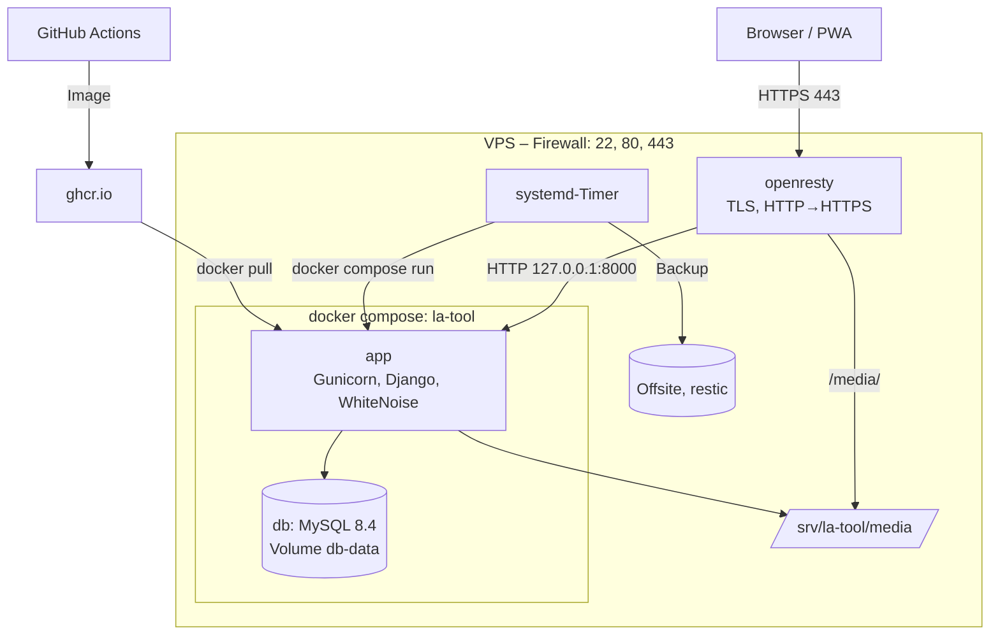

# Deployment

Bereitstellung im Produktivbetrieb nach der beschlossenen Zielarchitektur: **Docker Compose auf einem Linux-VPS hinter openresty**. Begründung und Alternativen: [Entscheidung 0001](entscheidungen/0001-deployment-strategie.md). Laufender Betrieb: [Betrieb](betrieb.md). Variablen: [Konfiguration](referenz/konfiguration.md).

> **Status:** Zielarchitektur beschlossen, **Umsetzung ausstehend**. `Dockerfile`, `compose.yaml`, `deploy/` und die CI existieren noch nicht im Repository; ihre Entwürfe stehen in der [Entscheidung](entscheidungen/0001-deployment-strategie.md#entwurf-der-container-dateien-schritt-4-ungetestet). Bis zur Umstellung gilt der [Übergangsbetrieb](deployment-uebergang.md).

## Umgebungen

| Umgebung | Zweck | Laufzeit | Datenbank |
|---|---|---|---|
| Entwicklung | Programmieren | venv, `runserver` ([Entwicklung](entwicklung.md)) | SQLite |
| Test | automatische Prüfung jedes Commits | GitHub Actions | SQLite (frisch je Lauf) |
| Staging (optional) | Update mit echten Daten erproben | zweites Compose-Projekt auf dem VPS | Kopie aus dem letzten Backup |
| Produktion | https://la-tool.thw-jugend-ge.de | Compose-Projekt `la-tool` | MySQL 8.4 (Container) |

## Architektur



| Komponente | Aufgabe |
|---|---|
| openresty (Host) | TLS-Zertifikate, Weiterleitung HTTP→HTTPS, Auslieferung von `/media/`, Weiterleitung an `127.0.0.1:8000` |
| `app` (Container) | Image `ghcr.io/luca-alexander-thomas/la-tool:<git-sha>`: Python 3.13, Gunicorn (2 Worker), Django, statische Dateien über WhiteNoise; läuft ohne Root |
| `db` (Container) | MySQL 8.4, nur im internen Compose-Netz erreichbar, Daten im Volume `db-data` |
| `/srv/la-tool/` (Host) | `compose.yaml`, `.env`, `db.env`, `media/`, Skripte |
| systemd-Timer (Host) | Management-Befehle und Backup |

## Server vorbereiten (einmalig)

1. **Betriebssystem** aktuell halten: `unattended-upgrades` aktivieren.
2. **Firewall:** eingehend nur 22, 80, 443 (z.&nbsp;B. `ufw allow OpenSSH; ufw allow 80,443/tcp; ufw enable`). SSH nur mit Schlüssel, `PermitRootLogin no`.
3. **Docker Engine** und Compose-Plugin aus dem offiziellen Docker-Repository installieren; `docker compose version` prüfen.
4. **Verzeichnisse:**

   ```bash
   sudo mkdir -p /srv/la-tool/media
   sudo chown 1000:1000 /srv/la-tool/media          # UID des Benutzers „app“ im Image
   ```

5. **Zugriff auf die Registry** (nur bei privatem Repository): `docker login ghcr.io` mit einem Token mit `read:packages`.

## Konfiguration

`/srv/la-tool/.env` (Besitzer root, `chmod 600`) – Variablen siehe [Konfiguration](referenz/konfiguration.md):

```ini
DEBUG=False
SECRET_KEY=<python -c "import secrets; print(secrets.token_urlsafe(50))">
HOSTNAME=la-tool.thw-jugend-ge.de
EXTRA_HOSTS=localhost                  # für den Container-Healthcheck
TRUST_X_FORWARDED_PROTO=True           # openresty setzt X-Forwarded-Proto

DB_MYSQL_PORT=3306
DB_MYSQL_USER=la_tool
DB_MYSQL_PASSWORD=<geheim, gleich wie in db.env>
DB_MYSQL_NAME=la_tool

AZURE_CLIENT_ID=…
AZURE_CLIENT_SECRET=…
AZURE_TENANT_ID=<Tenant-GUID>
AZURE_REDIRECT_URI=https://la-tool.thw-jugend-ge.de/microsoft-callback/
AZURE_GROUP_ADMINS_ID=…
AZURE_GROUP_USERS_ID=…

DIVERA_ADMIN_USER_API_KEY=…
DIVERA_SITE_ID=20369
DIVERA_EVENTS_GROUP=Jugendliche

VAPID_PUBLIC_KEY=…
VAPID_PRIVATE_KEY=…
VAPID_SUBJECT=mailto:<kontakt-adresse>
```

`DATABASE_TYPE=mysql` und `DB_MYSQL_HOST=db` setzt `compose.yaml`.

`/srv/la-tool/db.env` (`chmod 600`) für den Datenbank-Container:

```ini
MYSQL_DATABASE=la_tool
MYSQL_USER=la_tool
MYSQL_PASSWORD=<wie DB_MYSQL_PASSWORD>
MYSQL_ROOT_PASSWORD=<eigenes Geheimnis>
```

Das Image enthält keine Geheimnisse; beide Dateien gehören ins verschlüsselte Backup.

**Reverse-Proxy** (openresty/nginx, Ausschnitt):

```nginx
server {
    listen 443 ssl;
    server_name la-tool.thw-jugend-ge.de;
    client_max_body_size 20m;

    location /media/ { alias /srv/la-tool/media/; }

    location / {
        proxy_pass http://127.0.0.1:8000;
        proxy_set_header Host $host;
        proxy_set_header X-Forwarded-Proto $scheme;
        proxy_set_header X-Forwarded-For $proxy_add_x_forwarded_for;
    }
}
```

**Microsoft Entra (App-Registrierung):** Redirect-URI wie `AZURE_REDIRECT_URI`, delegierte Berechtigung `User.Read`.

## Release-Prozess

1. Änderungen per Pull-Request nach `main`; die CI führt `check`, `makemigrations --check`, Tests und `pip-audit` aus.
2. Nach grüner CI baut sie das Image und lädt es als `ghcr.io/luca-alexander-thomas/la-tool:<git-sha>` hoch.
3. Das Deployment wird **manuell** auf dem Server mit diesem Tag ausgelöst (siehe [Update](#update)).

Migrationsdateien sind ab der Umstellung **versioniert** und im Image enthalten; auf dem Server wird `makemigrations` nicht mehr ausgeführt.

## Erstinstallation

```bash
cd /srv/la-tool
# compose.yaml und deploy/ aus dem Repository hierher kopieren
export APP_TAG=<git-sha>
docker compose pull
docker compose up -d db
docker compose run --rm app python manage.py migrate
docker compose run --rm app python manage.py createsuperuser   # Notfall-Admin ohne Microsoft-Verknüpfung
docker compose run --rm app python manage.py check --deploy
docker compose up -d app
```

Danach Timer und Backup einrichten ([Betrieb](betrieb.md#wiederkehrende-aufgaben-timer)) und [verifizieren](#verifikation).

Umzug aus dem [Übergangsbetrieb](deployment-uebergang.md): Datenbank-Dump in den `db`-Container einspielen (`docker compose exec -T db mysql -u root -p la_tool < dump.sql`), `media/` nach `/srv/la-tool/media` kopieren, Migrationen wie in [Entscheidung 0001, Schritt 2](entscheidungen/0001-deployment-strategie.md#schritt-2-migrationen-versionieren-einmalig) abgleichen, openresty-Upstream umstellen, alten Dienst stoppen.

## Update

Über `deploy/deploy.sh <git-sha>` (Teil der Umsetzung). Das Skript führt diese Schritte aus, die auch von Hand gelten:

```bash
cd /srv/la-tool
NEW=<git-sha>; OLD=$(cat current-tag)

./deploy/backup.sh db-only "vor-$NEW"                          # Dump vor jeder Migration
APP_TAG=$NEW docker compose pull app
APP_TAG=$NEW docker compose run --rm app python manage.py migrate --plan   # prüfen
APP_TAG=$NEW docker compose run --rm app python manage.py migrate
APP_TAG=$NEW docker compose up -d app
# warten, bis der Container „healthy“ ist, sonst Rollback auf $OLD
echo $NEW > current-tag
```

Laufende Prüfungen und Sitzungen überstehen das Update (sie liegen in der Datenbank); die Zeit läuft während des Neustarts weiter.

## Verifikation

```bash
docker compose ps                                              # app und db „healthy“
curl -fsS https://la-tool.thw-jugend-ge.de/healthz/            # {"status": "ok"}
curl -sI https://la-tool.thw-jugend-ge.de/login/ | grep -iE "strict-transport|content-security"
journalctl CONTAINER_NAME=la-tool-app-1 -n 50
```

Im Browser: Anmeldung mit Divera und Microsoft, ein Training abschließen, Admin-Bereich öffnen.

## Rollback

| Fall | Vorgehen |
|---|---|
| Ohne Schemaänderung | `APP_TAG=<voriger-sha> docker compose up -d app`, `current-tag` zurücksetzen |
| Mit umkehrbarer Migration | im **neuen** Image zurückmigrieren: `APP_TAG=<neu> docker compose run --rm app python manage.py migrate <app> <vorige_migration>`, dann wie oben das alte Image starten |
| Mit nicht umkehrbarer Migration oder Datenfehlern | `app` stoppen, Dump „vor-<sha>“ einspielen ([Wiederherstellung](betrieb.md#backup-und-wiederherstellung)), altes Image starten |

## Fehler beim Deployment

| Symptom | Ursache und Lösung |
|---|---|
| `app` wird nicht „healthy“ | `docker compose logs app`; häufig `.env` unvollständig (`SECRET_KEY`), `localhost` fehlt in `EXTRA_HOSTS` (Healthcheck „400“) oder `db` nicht erreichbar |
| „400 Bad Request“ von außen | `HOSTNAME`/`EXTRA_HOSTS` passt nicht zum Hostnamen; openresty gibt `Host` nicht weiter |
| Endlose Weiterleitung | `SECURE_SSL_REDIRECT=True`, aber `X-Forwarded-Proto` fehlt bzw. `TRUST_X_FORWARDED_PROTO=False` |
| „CSRF-Prüfung fehlgeschlagen“ | Aufruf über HTTP oder `Host`/`X-Forwarded-Proto` fehlen |
| `migrate` meldet fehlende Tabellen oder Konflikte | Migrationsstand des Servers passt nicht zum Repository – nicht weiterarbeiten, Dump einspielen, Abgleich nach [Schritt 2](entscheidungen/0001-deployment-strategie.md#schritt-2-migrationen-versionieren-einmalig) |
| Uploads schlagen fehl | Rechte auf `/srv/la-tool/media` (UID 1000) oder `client_max_body_size` im Proxy |
| `docker compose pull` verweigert | Registry-Login fehlt (privates Repository) |
