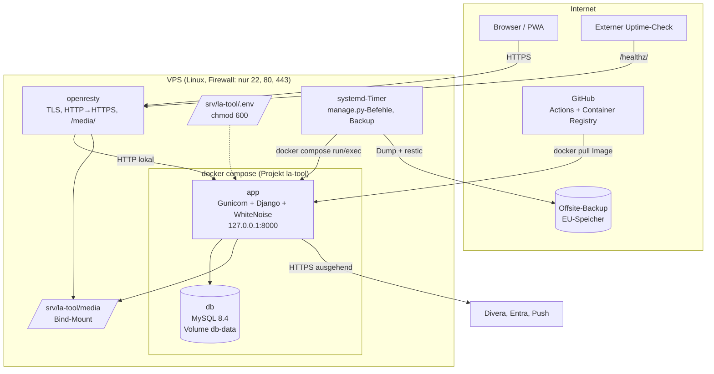
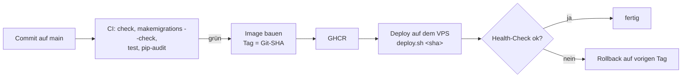

# Entscheidung 0001: Deployment-Strategie für den Produktivbetrieb

| | |
|---|---|
| Status | **Umgesetzt** am 11.11.2026, mit Abweichungen (siehe [Umsetzung](#umsetzung-11112026)) |
| Datum | 09.11.2026 |
| Betrifft | [Deployment](../deployment.md), [Betrieb](../betrieb.md) |

**Kurzfassung:** Das LA-Tool läuft künftig mit **Docker Compose auf dem vorhandenen Linux-VPS**, hinter dem bestehenden openresty. Dazu kommen versionierte Migrationen, eine GitHub-Actions-Pipeline (Tests, Image-Build), ein Deploy-Skript mit Rollback auf das vorherige Image sowie automatische, verschlüsselte Offsite-Backups. Kubernetes, PaaS und Managed-Container-Plattformen bringen für ein Ein-Personen-Ehrenamtsprojekt mit 30–50 Nutzern keinen Mehrwert, der ihre Kosten, Komplexität oder Datenschutzfragen rechtfertigt.


## Umsetzung (11.11.2026)

Die tatsächliche Umsetzung beschreibt [Deployment](../deployment.md). Abweichungen von den Entwürfen unten:

| Thema | Entwurf | Umgesetzt | Grund |
|---|---|---|---|
| Ist-Stand vorher | nativer Gunicorn-Dienst mit Daten | 1Panel-Python-Runtime mit `runserver`; Datenbank **ohne App-Tabellen und Konten** | – |
| Migrationen | Abgleich mit der Produktionsdatenbank (Schritt 2) | neu erzeugte `0001_initial` je App, kein Abgleich nötig | Produktionsdatenbank war leer |
| Build und Auslieferung | Image in der CI bauen, nach GHCR, Server zieht per Tag | Server baut das Image aus dem Git-Klon; Deploy per SSH aus GitHub Actions nach gemergtem Pull-Request (wie beim Projekt ConvertX-Frontend-M365 auf demselben Server) | einheitliches Verfahren auf dem Server, keine Registry nötig; die CI baut das Image trotzdem zur Prüfung |
| Pfad | `/srv/la-tool` | `/home/compose/la-tool` (Git-Klon) | Konvention auf dem Server |
| Port | `127.0.0.1:8000` | `127.0.0.1:8001` | 8000 belegt die alte Runtime bis zur Umstellung |
| Compose-Projekt | `la-tool` | `thw-la-tool` | 1Panel nutzt `la-tool` für die Runtime; gleiche Namen entfernen gegenseitig Container als „verwaist“ |
| `/media/` | liefert openresty aus | liefert Django aus | openresty (1Panel-Container) sieht das Projektverzeichnis nicht |
| Konfiguration | `.env` und `db.env` | nur `.env`; Compose initialisiert MySQL aus `DB_MYSQL_*` | eine Datei weniger |
| Logs | journald | Docker `json-file`, rotiert | wie die übrigen Container auf dem Server |
| Backup | restic offsite | lokal nach `backups/`, 14 Tage, täglich und vor jedem Deploy | **Offsite-Ziel fehlt noch** (offener Punkt) |

Die folgenden Abschnitte bleiben als Begründung der Entscheidung unverändert.

---

## 1. Ausgangslage

### Anwendung

- Django-6.0-Monolith (eine WSGI-Anwendung), Python ≥ 3.12, im Projekt 3.13.
- Server-gerenderte Seiten; das CSS ist vorgebaut und eingecheckt, ein JavaScript-Build gibt es nicht.
- Zustand liegt in der **Datenbank** (MySQL konfiguriert, SQLite möglich) und in **`media/`** (Uploads).
- Sitzungen und Prüfungsversuche liegen in der Datenbank. Der Cache ist prozesslokal (LocMem) und nicht kritisch.
- Wiederkehrende Aufgaben laufen als Management-Befehle über Timer (Divera-Abgleich, Löschkonzept, Erinnerungen).
- Externe Abhängigkeiten zur Laufzeit: Divera 24/7, Microsoft Entra/Graph, Web-Push-Dienste. Alle werden ausgehend über HTTPS angesprochen, eingehend wird nichts benötigt.

### Aktueller Deployment-Ansatz (Ist)

| Bereich | Ist-Zustand | Bewertung |
|---|---|---|
| Hosting | ein VPS, öffentlich, openresty als Reverse-Proxy | passend für die Größe |
| Laufzeit | venv + Gunicorn (2 sync-Worker), Konfiguration außerhalb des Repos (`bind 0.0.0.0:8000`) | Python-Version hängt am Betriebssystem; Port nach außen offen, sofern keine Firewall |
| Container | keine | – |
| Build/Release | manuell per SSH: `git pull`, `pip install`, `makemigrations`, `migrate`, `tailwind build`, `collectstatic`, Neustart | 7–8 Handschritte, fehleranfällig, nicht reproduzierbar |
| Migrationen | **nicht versioniert**, werden auf dem Server erzeugt | kein reproduzierbarer Schema-Stand, kein Zurückmigrieren |
| CI/CD | keine | Tests laufen nur lokal |
| Secrets | `.env` auf dem Server | angemessen, Rechte und Ablage undokumentiert |
| Logging | Gunicorn → journald | ausreichend |
| Monitoring | `/healthz/` vorhanden, keine Überwachung eingerichtet | Lücke |
| Backup | **kein Verfahren im Repository**, Zustand unbekannt | kritische Lücke |
| Rollback | nur von Hand (Git, venv, Datenbank) | langsam, unsicher |
| Umgebungen | Entwicklung lokal, Produktion; kein Test/Staging | für die Größe vertretbar, Tests vor Produktion fehlen |

**Fazit Ist:** Die Hosting-Grundlage (ein VPS mit Reverse-Proxy) passt. Was fehlt, sind Reproduzierbarkeit, Backups, ein kontrollierter Update- und Rollback-Weg sowie Überwachung. Diese Lücken liegen im **Prozess**, nicht in der Wahl der Plattform.

## 2. Anforderungen an den Produktivbetrieb

Ausdrückliche SLA-, Verfügbarkeits- oder Lastvorgaben gibt es nicht. Die folgenden Annahmen leiten sich aus Projekt und Nutzung ab und sind als solche gekennzeichnet:

| Annahme | Grundlage |
|---|---|
| A1 Last: 20–40 Jugendliche, 5–7 Betreuer; Spitzen bei Diensten und Übungsprüfungen (≤ 40 gleichzeitig) | `PROJEKT.md` |
| A2 Verfügbarkeit: „best effort“. Ausfall von Stunden ist tragbar, Datenverlust nicht (Prüfungsergebnisse, Lernstand) | Ehrenamt, keine Echtzeit-Funktion |
| A3 Betrieb durch **eine Person** ehrenamtlich; Übergabe an Nachfolger muss möglich sein | Projektkontext |
| A4 Personenbezogene Daten Minderjähriger → Hosting in der EU, möglichst Deutschland, Auftragsverarbeitung klar | DSGVO |
| A5 Budget: minimal, vorhandener VPS soll weitergenutzt werden | Ehrenamt |
| A6 Wiederherstellungsziele (Vorschlag): Datenverlust ≤ 24 h, Wiederherstellung ≤ 1 Arbeitstag | aus A2 abgeleitet, **mit Verantwortlichen abzustimmen** |

### Zwingend

1. **Automatische, verschlüsselte Backups** von Datenbank und `media/` außerhalb des Servers. Die Wiederherstellung wird regelmäßig getestet.
2. **Reproduzierbares Release-Artefakt** mit festen Versionen von Python, Abhängigkeiten und Code.
3. **Versionierte Migrationen**, vor Produktion geprüft, mit definiertem Rückweg.
4. **Kontrolliertes Update mit Rollback** auf die vorige Version in Minuten.
5. **Tests vor jedem Release** (automatisch).
6. **Secrets** nur auf dem Server, mit restriktiven Rechten, nicht im Image und nicht im Repository.
7. **Netz:** von außen nur 80/443 (SSH abgesichert), Anwendung und Datenbank nicht direkt erreichbar, TLS mit automatischer Erneuerung.
8. **Überwachung:** externe Erreichbarkeit über `/healthz/` und Benachrichtigung bei Ausfall oder fehlgeschlagenem Backup.
9. **Sicherheitsupdates** für Betriebssystem, Basis-Image und Python-Pakete in festem Rhythmus.

### Optional

- Staging-Umgebung auf demselben Server
- Fehler-Tracking (z.&nbsp;B. Sentry EU oder selbst gehostet)
- automatisches Deployment aus der CI
- Metriken und Dashboards
- Secrets verschlüsselt im Repository (sops/age)

## 3. Evaluierte Varianten

| # | Variante | Kurzbeschreibung |
|---|---|---|
| A | **VPS nativ (Ist)** | venv + Gunicorn + systemd, MySQL auf dem Host, manuelles Deployment |
| A+ | **VPS nativ, professionalisiert** | wie A, plus Deploy-Skript, versionierte Migrationen, CI, Backups, Monitoring, Python über `uv`/deadsnakes |
| B | **Docker Compose auf dem VPS** | App-Image (Gunicorn), MySQL-Container, openresty des Hosts davor; CI baut Images, Deploy per `docker compose` |
| C | PaaS (z.&nbsp;B. Render, Fly.io, Railway, Heroku) | Plattform betreibt Laufzeit; Datenbank und Speicher als Zusatzdienste |
| D | Managed Container (z.&nbsp;B. Azure Container Apps, Google Cloud Run) | Container auf einer Cloud-Plattform; Datenbank, Dateispeicher und Scheduler als Cloud-Dienste |
| E | Kubernetes (k3s auf VPS oder verwaltet) | Orchestrierung mit Deployments, Ingress, CronJobs, Volumes |
| F | Shared/Managed Hosting mit Python (z.&nbsp;B. Uberspace) | ohne Root, Python-Laufzeit und Datenbank vom Anbieter, in Deutschland |

Nicht weiter betrachtet wurden Serverless-Funktionen (passen nicht zu einer Django-Anwendung mit Sitzungen und Hintergrundbefehlen) und Multi-Server-Hochverfügbarkeit (nicht gefordert, siehe A2).

## 4. Vergleich

Bewertung 1 (schlecht) bis 5 (sehr gut), bezogen auf **dieses** Projekt und die Annahmen A1–A6.

| Kriterium | A Ist | A+ nativ prof. | **B Compose** | C PaaS | D Managed Container | E Kubernetes | F Shared Hosting |
|---|---|---|---|---|---|---|---|
| Kompatibilität mit der Anwendung | 5 | 5 | 5 | 3 (Dateispeicher, Cron) | 3 (Dateispeicher, Cron) | 4 | 4 |
| Reproduzierbarkeit | 1 | 3 | **5** | 4 | 5 | 5 | 2 |
| Rollback | 1 | 3 | **5** (Image-Tag) | 4 | 4 | 5 | 2 |
| Stabilität/Verfügbarkeit (bei A2) | 3 | 4 | 4 | 4 | 4 | 4 | 3 |
| Skalierbarkeit (Bedarf gering) | 3 | 3 | 4 | 5 | 5 | 5 | 2 |
| Administrativer Aufwand | 2 | 3 | **4** | 4 | 3 | 1 | 4 |
| Komplexität (5 = einfach) | 4 | 4 | 4 | 3 | 2 | 1 | 4 |
| Sicherheit/Isolation | 3 | 3 | **4** | 4 | 4 | 4 | 3 |
| Datenschutz (EU, Kontrolle) | 5 | 5 | **5** | 2–3 | 3 | 4–5 | 5 |
| Laufende Kosten | 5 | 5 | **5** | 2 | 2 | 3–4 | 5 |
| Anbieterabhängigkeit (5 = gering) | 5 | 5 | **5** | 2 | 2 | 4 | 3 |
| Übergabe an Nachfolger | 2 | 3 | **5** | 4 | 3 | 2 | 3 |
| **Summe** | 39 | 46 | **55** | ~40 | ~40 | ~42 | 40 |

### Begründungen

**A – Ist:**
- Funktioniert, aber jedes Update besteht aus vielen Handschritten.
- Migrationen entstehen auf dem Server, ein Backup-Verfahren fehlt, ein Rollback ist praktisch unmöglich.
- Die Python-Version hängt am Betriebssystem: Ubuntu 24.04 liefert 3.12, Debian 12 liefert 3.11. Debian 12 reicht für Django 6 also nicht.

**A+ – nativ professionalisiert:**
- Beseitigt die meisten Prozesslücken ohne neue Technik.
- Offen bleiben die Kopplung an Betriebssystem und Python, ein Rollback nur über Git plus venv-Neuaufbau, und Unterschiede zwischen Entwicklungsrechner und Server.
- Ein guter zweiter Platz und sinnvoll, falls Docker auf dem VPS nicht gewünscht ist (siehe [Abschnitt 8](#8-wann-sich-die-empfehlung-ändert)).

**B – Docker Compose:**
- **Reproduzierbarkeit:** Ein Image enthält Python 3.13, `mysqlclient` samt Build-Abhängigkeiten, Code und statische Dateien. Getestet in der CI, unverändert ausgerollt.
- **Rollback und Isolation:** Ein Rollback ist der Wechsel auf den vorigen Image-Tag. Anwendung und Datenbank laufen isoliert, die Datenbank ist nicht im Netz.
- **Übergabe:** `compose.yaml` dokumentiert die komplette Laufzeit-Infrastruktur, eine Nachfolgerin muss nur Docker kennen.
- **Geringe Zusatzkomplexität:** keine Orchestrierung, ein Server, der bestehende Proxy bleibt.
- **Kosten:** keine zusätzlichen. Das Repository ist öffentlich; GitHub Actions und öffentliche Pakete in der GitHub Container Registry sind dafür kostenfrei.

**C – PaaS:**
- Komfortabel, aber für Uploads braucht es zusätzlichen Objektspeicher, und Timer laufen nur über plattformeigene Scheduler.
- Die Datenbank ist ein kostenpflichtiger Zusatzdienst. Bei mehreren Diensten liegen die Kosten erfahrungsgemäß im Bereich von 15–40 €/Monat statt einem bereits bezahlten VPS.
- Mehrere Anbieter sitzen in den USA (Datenschutz bei Daten Minderjähriger), dazu kommt die Bindung an den Anbieter.
- Kein Vorteil bei der Last aus A1.

**D – Managed Container:**
- Ähnliche Argumente wie bei C.
- Dateispeicher und Scheduler müssen zusätzlich angebunden werden (Azure Files/Blob, Jobs).
- Kosten und Betriebsmodell der Cloud müssen erlernt werden.
- Die vorhandene Entra-Anbindung spricht nicht für Azure-Hosting, denn die Anmeldung funktioniert unabhängig vom Hosting.

**E – Kubernetes:**
- Bringt Self-Healing, Rolling Updates und horizontale Skalierung. Davon wird bei einer Anwendung mit 2 Workern und ohne Hochverfügbarkeits-Anforderung nichts gebraucht.
- Dafür kommen Cluster-Betrieb, Ingress, persistente Volumes, Zertifikats-Operator, CronJobs und Upgrades des Clusters dazu: deutlich mehr Wissen und Pflege für eine Person.
- **Ergebnis: unnötige Komplexität, verworfen.**

**F – Shared Hosting:**
- Günstig, in Deutschland, wenig Administration.
- Weniger Kontrolle bei Python-Version, Prozessmodell und Backups. Kein Container-Artefakt, Rollback wie bei A.
- Ein Umzug weg vom vorhandenen VPS bringt keinen Gewinn.

## 5. Empfehlung: Docker Compose auf dem vorhandenen VPS

### Zielarchitektur



### Komponenten

| Komponente | Umsetzung | Begründung |
|---|---|---|
| Reverse-Proxy | **bestehendes openresty** auf dem Host (TLS, Weiterleitung, `/media/`) | läuft bereits und verwaltet die Zertifikate; kein zweiter Proxy |
| Anwendung | Image `ghcr.io/luca-alexander-thomas/la-tool:<git-sha>`, Python 3.13-slim, Gunicorn, Benutzer ohne Root | reproduzierbar, unabhängig von der Python-Version des Hosts |
| Datenbank | MySQL 8.4 LTS als Container, Volume `db-data`, nicht nach außen veröffentlicht | Django 6 verlangt MySQL ≥ 8.0.11. Bei der Last wäre SQLite technisch ausreichend; MySQL ist aber bereits konfiguriert und robuster bei gleichzeitigen Schreibzugriffen (Prüfungs-Autosave) |
| Uploads | Bind-Mount `/srv/la-tool/media` → `/app/media` | openresty liefert die Dateien direkt aus; einfach zu sichern |
| Konfiguration | `/srv/la-tool/.env` (root, `600`), per `env_file` | keine Secrets in Image oder Repository |
| Zeitgesteuerte Aufgaben | systemd-Timer auf dem Host → `docker compose run --rm app python manage.py …` | ein Scheduler, sichtbar über `systemctl list-timers`, Logs in journald |
| Logs | Docker-Logtreiber `journald` | alles an einem Ort: `journalctl CONTAINER_NAME=…` |
| CI | GitHub Actions: Tests → Image bauen → GHCR | Test vor jedem Release; Artefakt identisch für alle Umgebungen |
| Backup | systemd-Timer: DB-Dump + `media/` → **restic** in EU-Speicher (z.&nbsp;B. Storage Box), verschlüsselt | Offsite, Versionen, Verschlüsselung |
| Monitoring | Docker-Healthcheck, externer Uptime-Check auf `/healthz/`, Meldung bei fehlgeschlagenen Timern | Ausfälle und stille Backup-Fehler werden bemerkt |

### Netzwerk- und Sicherheitskonzept

- **Firewall** (ufw/nftables): eingehend nur 22, 80, 443. SSH nur mit Schlüssel, ohne Root-Login; fail2ban optional.
- **Ports:** App veröffentlicht nur `127.0.0.1:8000`, die Datenbank veröffentlicht keinen Port (nur internes Compose-Netz).
- **Container:** App läuft als unprivilegierter Benutzer und schreibt nur in `media/`; Image ohne Build-Werkzeuge (Multi-Stage).
- **TLS:** Zertifikate verwaltet openresty wie bisher (automatische Erneuerung prüfen).
- **Django:** `TRUST_X_FORWARDED_PROTO=True`, HSTS, CSP, sichere Cookies (siehe [Sicherheit](../sicherheit-datenschutz.md)).
- **Secrets:** `.env` (`600`, root) auf dem Server, im verschlüsselten Backup enthalten. Das restic-Passwort liegt zusätzlich offline beim Verantwortlichen. GitHub braucht nur das automatische `GITHUB_TOKEN` zum Push nach GHCR.
- **Updates:**
  - `unattended-upgrades` für das Betriebssystem
  - Dependabot für `requirements.txt`, Dockerfile und Actions
  - Image monatlich neu bauen (Basis-Image-Patches)
  - `pip-audit` in der CI

### Datenbank und persistente Daten

| Daten | Ort | Sicherung |
|---|---|---|
| Datenbank | Volume `db-data` | täglicher Dump (`mysqldump --single-transaction`), restic |
| Uploads | `/srv/la-tool/media` | restic (inkrementell) |
| Konfiguration | `/srv/la-tool/.env`, `compose.yaml` | restic; `compose.yaml` zusätzlich im Repository |
| Migrationen | **im Repository und im Image** | Git |

Aufbewahrung im Backup (Vorschlag): 7 tägliche, 4 wöchentliche, 6 monatliche Stände. Wiederherstellung einmal im Quartal testen. Die Fristen des [Löschkonzepts](../sicherheit-datenschutz.md#löschkonzept) gelten für Backups mit Verzögerung: Gelöschte Daten verschwinden spätestens nach Ablauf der Backup-Aufbewahrung (in der Datenschutzerklärung erwähnen).

### Build-, Release- und CI/CD-Konzept



- **Trunk-basiert:** `main` ist auslieferbar. Feature-Branches mit Pull-Request, die CI muss grün sein.
- **Deployment zunächst manuell ausgelöst** über ein Skript auf dem Server mit einem bestimmten Tag. Die Person behält die Kontrolle über Zeitpunkt und Migrationen. Eine Automatisierung per SSH aus GitHub Actions ist später optional.
- **Migrationen:** werden im Repository erstellt und in der CI geprüft. Beim Deployment vorher `migrate --plan`, danach `migrate` im neuen Image, bevor der Dienst umgeschaltet wird. Vor jeder Migration läuft ein Backup.

### Update- und Rollback-Verfahren (Ziel)

1. `deploy.sh <sha>` sichert die Datenbank (Dump mit Tag), lädt das Image und zeigt `migrate --plan`.
2. Nach Bestätigung: `migrate` im neuen Image, `docker compose up -d app`, Warten auf den Healthcheck.
3. Schlägt der Healthcheck fehl, wird automatisch wieder das vorige Image gestartet.
4. Rollback mit Schemaänderung: zurückmigrieren (`migrate <app> <vorige_migration>`, wenn umkehrbar) oder den Dump des Schritts 1 einspielen.

### Umgebungen

| Umgebung | Zweck | Umsetzung |
|---|---|---|
| Entwicklung | Programmieren | lokal mit venv und SQLite wie bisher ([Entwicklung](../entwicklung.md)); optional `docker compose` zum Prüfen des Images |
| Test | automatische Prüfung | GitHub Actions (frische Datenbank je Lauf) |
| Staging (optional) | Probe eines Updates mit echten Daten | zweites Compose-Projekt auf dem VPS (eigener Port, eigene Datenbank aus dem letzten Backup, Zugriff nur per SSH-Tunnel oder Basic Auth) |
| Produktion | Betrieb | wie oben |

## 6. Risiken und Einschränkungen

| Risiko | Wirkung | Gegenmaßnahme |
|---|---|---|
| Ein Server = Single Point of Failure | Ausfall bis zur Wiederherstellung | Backups offsite, dokumentierte Wiederherstellung auf neuem VPS (Compose macht das schnell); bei A2 akzeptiert |
| Umstellung der Migrationen | Fehler beim Abgleich zerstören Daten | einmaliges, geprüftes Verfahren mit Backup ([Schritt 2](#7-umsetzungsschritte-und-reihenfolge)) |
| Docker-Kenntnisse beim Betreiber | Fehlbedienung | Skripte (`deploy.sh`, `backup.sh`), Doku, Probe auf Staging |
| Image-Registry nicht erreichbar | kein Update möglich | laufender Betrieb nicht betroffen; vorige Images bleiben lokal |
| LocMem-Cache je Worker | Drosselung und Zähler je Worker | bekannt und akzeptiert; Redis wäre erst bei mehr Workern sinnvoll |
| Ein Betreiber (Bus-Faktor) | Stillstand bei Ausfall der Person | Doku, Zugangsdaten hinterlegt (Notfallumschlag), zweite Person einweisen |

## 7. Umsetzungsschritte und Reihenfolge

Jeder Schritt ist für sich nützlich und kann einzeln umgesetzt werden. **Schritt 1 ist sofort und unabhängig von allem anderen nötig.**

| # | Schritt | Art | Abhängig von |
|---|---|---|---|
| 1 | **Backups einrichten** im Übergangsbetrieb: Dump + `media/` + `.env` per restic offsite, Timer, Restore-Probe | Betrieb | – |
| 2 | **Migrationen versionieren** (Verfahren siehe unten) | Repository + einmalig Server | 1 |
| 3 | **CI** `.github/workflows/ci.yml`: check, `makemigrations --check`, test, pip-audit | Repository | 2 |
| 4 | **Container-Dateien** im Repository: `Dockerfile`, `.dockerignore`, `compose.yaml`, `deploy/gunicorn.conf.py`, `deploy/deploy.sh`, `deploy/backup.sh`; lokal bzw. auf Staging erproben | Repository | 2 |
| 5 | **Image-Build in der CI** → GHCR | Repository | 3, 4 |
| 6 | **Staging** auf dem VPS mit Kopie der Produktionsdaten | Server | 5 |
| 7 | **Umstellung** im Wartungsfenster: Dump aus Host-MySQL (bzw. SQLite) in den DB-Container, `media/` verschieben, openresty-Upstream auf `127.0.0.1:8000` (Compose), Timer auf `docker compose run` umstellen, alten Gunicorn-Dienst stoppen (nicht löschen) | Server | 6 |
| 8 | **Überwachung:** externer Uptime-Check, Meldung bei Timer-Fehlern, Dependabot | Betrieb | 7 |
| 9 | Nach 2–4 Wochen stabilem Betrieb: alten venv-Dienst entfernen, `docs/deployment-uebergang.md` löschen | Server + Doku | 8 |

### Schritt 2: Migrationen versionieren (einmalig)

Ziel: Die Migrationsdateien im Repository passen zum Schema der Produktionsdatenbank.

1. Backup (Schritt 1).
2. Auf dem Server mit dem aktuellen Stand `makemigrations` und `migrate` ausführen, bis `makemigrations --check` „No changes detected“ meldet. Dann entspricht das Schema den Modellen.
3. Im Repository `*/migrations/` aus `.gitignore` entfernen, lokal neue Ausgangs-Migrationen erzeugen (`makemigrations app la_tool_admin` in einer leeren Datenbank) und committen. Den `post_migrate`-Hook in `app/apps.py` prüfen: Er muss weiter idempotent laufen.
4. Auf dem Server: alte Migrationsdateien sichern und entfernen, die neuen einspielen, dann die bisherigen Einträge in `django_migrations` für `app` und `la_tool_admin` löschen und `python manage.py migrate --fake-initial` ausführen. Danach muss `showmigrations` alle Migrationen als angewendet zeigen und `makemigrations --check` darf keine Änderungen melden.
5. Ab jetzt: Migrationen entstehen nur noch im Repository.

### Entwurf der Container-Dateien (Schritt 4, ungetestet)

Die folgenden Dateien sind **Vorschläge**, die zur Umsetzung ins Repository kommen. Sie wurden nicht gebaut, weil Docker auf dem Entwicklungsrechner nicht installiert war. Vor dem Einsatz lokal oder auf Staging erproben.

`Dockerfile`

```dockerfile
# --- Build: Abhängigkeiten inkl. mysqlclient kompilieren ---
FROM python:3.13-slim AS build
RUN apt-get update && apt-get install -y --no-install-recommends \
        build-essential pkg-config default-libmysqlclient-dev \
    && rm -rf /var/lib/apt/lists/*
COPY requirements.txt .
RUN pip wheel --no-cache-dir --wheel-dir /wheels -r requirements.txt "mysqlclient>=2.2.0" "gunicorn>=23"

# --- Laufzeit ---
FROM python:3.13-slim
RUN apt-get update && apt-get install -y --no-install-recommends libmariadb3 \
    && rm -rf /var/lib/apt/lists/* \
    && useradd --create-home --uid 1000 app
COPY --from=build /wheels /wheels
RUN pip install --no-cache-dir /wheels/* && rm -rf /wheels
WORKDIR /app
COPY --chown=app:app . .
# CSS ist eingecheckt (assets/css/tailwind.css); hier nur statische Dateien sammeln
RUN DEBUG=False SECRET_KEY=build-only python manage.py collectstatic --noinput
USER app
EXPOSE 8000
HEALTHCHECK --interval=30s --timeout=5s --retries=3 \
    CMD python -c "import os,urllib.request; urllib.request.urlopen(urllib.request.Request('http://127.0.0.1:8000/healthz/', headers={'Host': os.environ.get('HOSTNAME_HEALTH', 'localhost')}), timeout=4)"
CMD ["gunicorn", "-c", "deploy/gunicorn.conf.py", "la_tool.wsgi"]
```

`.dockerignore` (verhindert, dass Geheimnisse und lokale Daten ins Image gelangen)

```text
.env
db.sqlite3
divera.json
media/
staticfiles/
old/
.git/
.django_tailwind_cli/
**/__pycache__/
Konzept LA-Tool.pdf
```

`compose.yaml`

```yaml
name: la-tool
services:
  app:
    image: ghcr.io/luca-alexander-thomas/la-tool:${APP_TAG:?APP_TAG setzen}
    env_file: /srv/la-tool/.env
    environment:
      DATABASE_TYPE: mysql
      DB_MYSQL_HOST: db
    ports:
      - "127.0.0.1:8000:8000"
    volumes:
      - /srv/la-tool/media:/app/media
    depends_on:
      db:
        condition: service_healthy
    restart: unless-stopped
    logging:
      driver: journald
  db:
    image: mysql:8.4
    env_file: /srv/la-tool/db.env      # MYSQL_DATABASE, MYSQL_USER, MYSQL_PASSWORD, MYSQL_ROOT_PASSWORD
    volumes:
      - db-data:/var/lib/mysql
    healthcheck:
      test: ["CMD", "mysqladmin", "ping", "-h", "127.0.0.1", "--silent"]
      interval: 10s
      retries: 10
    restart: unless-stopped
    logging:
      driver: journald
volumes:
  db-data:
```

`deploy/gunicorn.conf.py`

```python
bind = "0.0.0.0:8000"        # im Container; nach außen nur 127.0.0.1 (compose.yaml)
workers = 2
worker_class = "sync"
timeout = 120
accesslog = "-"
errorlog = "-"
loglevel = "info"
```

`.github/workflows/ci.yml` (Kern)

```yaml
name: CI
on: [push, pull_request]
jobs:
  test:
    runs-on: ubuntu-latest
    steps:
      - uses: actions/checkout@v4
      - uses: actions/setup-python@v5
        with: { python-version: "3.13" }
      - run: pip install -r requirements.txt
      - run: python manage.py check
        env: { DEBUG: "True" }
      - run: python manage.py makemigrations --check --dry-run
        env: { DEBUG: "True" }
      - run: python manage.py test
        env: { DEBUG: "True" }
  image:
    needs: test
    if: github.ref == 'refs/heads/main'
    runs-on: ubuntu-latest
    permissions: { contents: read, packages: write }
    steps:
      - uses: actions/checkout@v4
      - uses: docker/login-action@v3
        with: { registry: ghcr.io, username: "${{ github.actor }}", password: "${{ secrets.GITHUB_TOKEN }}" }
      - uses: docker/build-push-action@v6
        with: { push: true, tags: "ghcr.io/luca-alexander-thomas/la-tool:${{ github.sha }}" }
```

Hinweise zu den Entwürfen:

- **Healthcheck:** Der Health-Request braucht einen erlaubten Hostnamen. Dafür entweder `localhost` in `EXTRA_HOSTS` aufnehmen oder `HOSTNAME_HEALTH` auf den Produktions-Hostnamen setzen.
- **Gunicorn:** `gunicorn` ist bisher nicht in `requirements.txt`, sondern nur auf dem Server installiert. Für das Image ist es im Dockerfile ergänzt. Alternativ in eine eigene `requirements-prod.txt` aufnehmen.
- **Image-Name und Sichtbarkeit:** Das Repository ist öffentlich, das Image wird ebenfalls öffentlich (Paket-Sichtbarkeit in GHCR einmalig auf „public“ stellen). Der Server braucht dann keinen Registry-Login. Das Image enthält nur, was ohnehin öffentlich ist: Code und statische Dateien, keine `.env`, keine Daten (siehe `.dockerignore`).
- **Timer:** `ExecStart=/usr/bin/docker compose -f /srv/la-tool/compose.yaml run --rm app python manage.py sync_divera`.
- **`deploy.sh`** und **`backup.sh`** sind in Schritt 4 zu schreiben. Ihr Ablauf steht in [Abschnitt 5](#update--und-rollback-verfahren-ziel) und unter [Datenbank und persistente Daten](#datenbank-und-persistente-daten).

## 8. Wann sich die Empfehlung ändert

| Bedingung | Dann |
|---|---|
| Docker ist auf dem VPS nicht gewünscht oder nicht möglich, oder weitere native Dienste machen Docker unpraktisch | **Variante A+**: Schritte 1–3 und 8 genauso, statt Image ein Deploy-Skript mit venv je Release (`/srv/la-tool/releases/<sha>`, Symlink `current`) und Python 3.13 über `uv` |
| Verbindliche Hochverfügbarkeit, z.&nbsp;B. Prüfungen nur noch über das Tool mit Ausfallverbot | zweiter Server, verwaltete Datenbank, Objektspeicher für Uploads; Compose bleibt das Artefakt (Wechsel auf Managed Container dann prüfen) |
| Deutlich mehr Nutzer (z.&nbsp;B. mehrere Ortsverbände, > 500 aktiv) | mehr Worker, gemeinsamer Cache (Redis) statt LocMem, ggf. getrennter DB-Server; Kubernetes erst bei mehreren Diensten und Teams |
| Kein Betreiber mehr mit Server-Kenntnissen | Managed Hosting (Variante F) oder PaaS mit EU-Region, unter Inkaufnahme von Kosten und Anpassungen (Dateispeicher, Scheduler) |

## 9. Offene Fragen

1. **VPS:** Anbieter, Standort, Betriebssystem und Version, CPU, RAM, Plattenplatz. Laufen weitere Dienste darauf? (Entscheidet über Docker und Ressourcen.)
2. **Produktionsdatenbank:** Läuft schon MySQL oder noch SQLite? (Betrifft Schritt 7.)
3. **Backup-Ziel:** Gibt es EU-Speicher (z.&nbsp;B. Storage Box) und wer hält das Backup-Passwort?
4. **Wiederherstellungsziele:** A6 mit den Verantwortlichen bestätigen.
5. ~~Repository öffentlich oder privat?~~ **Geklärt:** öffentlich, aber nur für die THW-Jugend Gelsenkirchen entwickelt. Folgen siehe [Öffentliches Repository](#öffentliches-repository).
6. **Zertifikate:** Wie erneuert openresty sie? Setzt es `X-Forwarded-Proto`?
7. **Zweite Person** mit Zugang für den Notfall?

## Öffentliches Repository

Das Repository ist öffentlich, die Anwendung ist aber nur für die THW-Jugend Gelsenkirchen gedacht (z.&nbsp;B. feste Divera-Standort-ID `20369` und Qualifikations-IDs in `Profile.QUAL_MAP`, Branding). Für den Betrieb bedeutet das:

- **CI und Registry kostenfrei**, das Image ist öffentlich abrufbar, der Server braucht keinen Registry-Zugang.
- **Nichts Geheimes ins Repository oder Image:** `.env`, `db.env`, Datenbanken, `divera.json` und `media/` sind über `.gitignore` bzw. `.dockerignore` ausgeschlossen. Bei Pull-Requests aus Forks laufen in GitHub Actions keine Secrets; die CI braucht für die Tests auch keine.
- **Alter `SECRET_KEY`** stand früher in der öffentlichen Git-Historie: in Produktion zwingend einen neuen verwenden.
- **Image-Push** nur aus `main` im eigenen Repository (Bedingung `github.ref == 'refs/heads/main'` im Entwurf), nicht aus Pull-Requests.
- Eine Verallgemeinerung für andere Ortsverbände ist ausdrücklich **nicht** Ziel; organisationsspezifische Werte bleiben im Code bzw. in der `.env`.

## 10. Auswirkungen auf die Dokumentation

| Dokument | Änderung |
|---|---|
| [Deployment](../deployment.md) | beschreibt die Zielarchitektur (Compose), mit Status-Hinweis |
| Übergangsbetrieb (Dokument entfallen) | **neu:** bisheriges natives Verfahren, gilt bis Schritt 7, danach löschen |
| [Betrieb](../betrieb.md) | Befehlsaufruf je Umgebung, Backup mit restic, Monitoring |
| [Architektur](../architektur.md) | Verweis auf diese Entscheidung; Migrationen werden versioniert (ab Schritt 2) |
| [Konfiguration](../referenz/konfiguration.md) | Compose-spezifische Werte (`APP_TAG`, `db.env`) |
